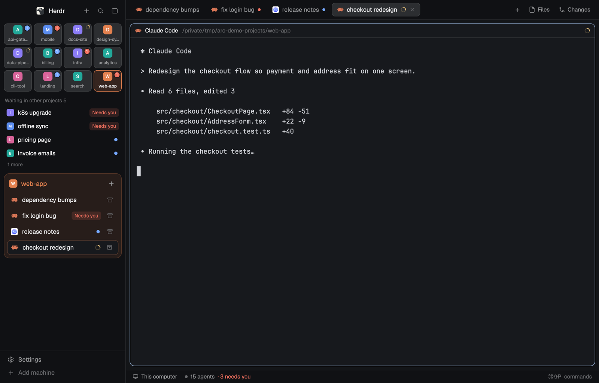

# herdr-arc

An Arc / Dia style sidebar layout for [Herdr](https://herdr.dev): projects as
a tile grid on top with status lights, click one to see only its sessions and
what each agent is doing, with a menu to restart, close or resume it.

| Layout | |
| --- | --- |
| [Arc](arc/) | project tiles with status lights, the chosen project's sessions with a "doing now" line and a restart / close / resume menu |
| [Board](arc/RECIPE.md#board) | a side panel per project or conversation: what agents wait on you for (decisions are one-click replies), next step, PRs from `gh`, what can ship |

Install: copy `arc/layouts/arc.json` and `arc/mods/` into
`~/.config/herdr-app/`, then `herdr-app do layout.switch '{"name":"arc"}'`.
English and Chinese: set `"lang": "zh"` in the layout for Chinese ([screenshot](arc/preview-zh.png)).
See [arc/RECIPE.md](arc/RECIPE.md) for what it does and how to rebuild it.

`mods/arc-chrome` and `mods/arc-tabs` are adapted from Herdr's `workspace-chrome`
and `tabs` mods (Apache-2.0). Phosphor icons are MIT (`ph/`, `glyphs/`).
Everything else here is Apache-2.0.

`agentnow.py` and the board's `boardnow.py` send digests of each agent's activity to the model
endpoint in your Claude Code settings; see [Watch out](arc/RECIPE.md#watch-out).
