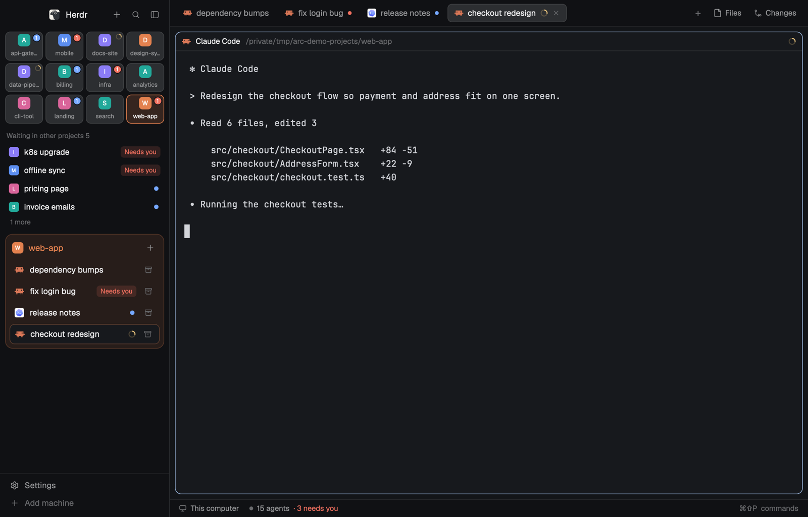

# Arc

An Arc / Dia style sidebar for Herdr. Projects sit in a grid of tiles at the
top; click one and the sidebar shows only that project's sessions, so it's
less to read.

This file is the brief: enough to build Arc from an empty folder. The files
next to it are one build of it.

The sidebar speaks English or Chinese. Mods can't see the system language,
so the layout picks it: `"props": { "lang": "zh" }` on the `arc-sidebar` and
`arc-chrome` blocks in `layouts/arc.json` (`"en"` is the default).
[中文界面截图](preview-zh.png)

## What you see

The `main` layout with its left sidebar replaced, top to bottom:

1. **Header** (`mods/arc-chrome`, a copy of the shipped `workspace-chrome`
   header): Herdr mark, then **+ new project**, search, sidebar toggle.
2. **Project tiles**, 46px high, as many columns as fit (4 at 268px; 2 to 8 as you drag the sidebar): each project (space) is a
   colored initial (or a logo you add) with its name under it. The selected
   one is tinted and outlined in its color. The corner badge counts that
   project's agents that need you (blocked first, else done and unseen); a
   spinner when one is only working. Every project is pinned until you
   change it: right-click a tile to unpin, right-click a project in the
   bottom strip to pin it back. No limit.
   With projects on more than one machine, the tiles split into one block
   per machine (this computer first), each under a small monitor/server icon,
   the machine's name and its count. Click a machine's heading to fold it
   (kept in `shared("arc.folded")`); folded, it still shows how many of its
   agents need you. the project card's header names its
   machine too. Rename machines with `"props": { "machines": { "local":
   "MacBook Air", "cn": "Mac mini" } }` on the `arc-sidebar` block.
3. **Other projects waiting on you**: up to four blocked or done agents from
   other projects, each with its project's mark. Click to jump there.
   Filtering to one project never hides work that needs you.
4. **The project card**, tinted in the project's color: its name and branch,
   + new session, then one row per tab with the agent's icon, its name and
   status (spinner, Needs you badge, or done dot) and a settle button.
   - Pinned agents (`terminal.pin`) come first, like Arc's Pinned over Today.
   - Idle tabs untouched for 12 hours fold into **Older N** (only folded,
     never closed).
   - Settled tabs fold into **Settled N**. Nothing is settled automatically:
     working or waiting agents stay in the list.
5. **Other projects**: unpinned projects as small marks along the bottom,
   ones that need you first. Empty while everything is pinned.

Project colors are the same table as the shipped Spaces list, and
`shared("space.colors")` wins, so a project has one color everywhere.

## How it behaves

- **Statuses.** Working: a spinner in the theme's `working` color on the tile
  corner and the tab row. Blocked: a red count badge on the tile, a red
  "Needs you" pill on the row, and the agent listed under "Waiting in other
  projects". Done (finished while you weren't looking): a blue count badge /
  dot, also listed there. Idle: nothing.
- **Clicks.** A tile or bottom mark runs `space.select`. A row in "Waiting in
  other projects" runs `agent.focus` on that terminal. A tab row selects the
  tab; its archive button runs `tab.settle` (or `tab.unsettle` when
  settled). The card's + runs `tab.new` in that space; the header's + runs
  `space.new`.
- **Right-click** a tile to unpin it, a bottom mark to pin it. Pins are kept
  in `shared("arc.pinned")`; until the first change every project is pinned,
  new ones included.
- Folds (Older, Settled) open and close on click and remember nothing.
- Hovers show the full name and status in a tooltip.

## Built from

- `layouts/arc.json`: the shipped `main` window with its sidebar column's
  middle block replaced. Sidebar column, 268px and draggable: `brand` block (46px,
  `mod: arc-chrome`), `projects` block (`mod: arc-sidebar`), footer block
  (69px, shipped `workspace-chrome` with `props.footer`). Both arc blocks
  take `props.lang`.
- `mods/arc-sidebar`: one `View`; reads `spaces()`, `agents()`, `theme()`,
  `shared()`, `props()`; writes `setShared("arc.pinned")`; runs
  `space.select`, `agent.focus`, `tab.select`, `tab.new`, `tab.settle`,
  `tab.unsettle`. Icons come from the shipped `mods/workspace-chrome/*.svg`.
- `mods/arc-chrome`: the shipped `workspace-chrome` header plus a +
  (`space.new`).

## Watch out

- Mods can't read the system language (no `Intl`, no `navigator`), hence
  `props.lang`.
- An `AvatarImage` whose file is missing draws nothing, not its fallback;
  only give an image to names you have a file for.
- `done` only shows if the agent went working → done while unseen; an
  agent that reports done straight away reads as idle.
- Tile names truncate at about 10 characters at 268px; a wider sidebar adds columns, not wider tiles.
- `arc-chrome` is a copy: it won't pick up later changes to the shipped
  header.

## Done when

- Every project shows as a tile, 4 per row; the selected one is outlined
  in its color, and the same color as in the Spaces list.
- A blocked agent in another project shows a red badge on its tile and a
  row under "Waiting in other projects" that jumps to it.
- Clicking a tile shows only that project's tabs in the card.
- Settling a tab moves it under "Settled N"; its program keeps running.
- Right-click unpin moves a project to the bottom strip; right-click there
  pins it back.
- `"lang": "zh"` switches every word in the sidebar to Chinese.

## Logos

To show a project's own logo instead of its initial, put a PNG in
`mods/arc-sidebar/logos/` and list the space name in `LOGOS` at the top of
`mods/arc-sidebar/main.js`. Only listed names get an image: Herdr draws a
missing image as blank, not as the fallback.

## Install

Copy `layouts/arc.json` and `mods/` into `~/.config/herdr-app/`, run
`herdr-app check mods/arc-sidebar`, then `herdr-app do layout.switch
'{"name":"arc"}'` (or `ctrl-shift-l`). The last layout you used is the one
Herdr opens with.

## Why it looks like this

Arc puts global Favorites on top and switches Spaces at the bottom; Zen and
Floorp do much the same. Here the top grid *is* the project switcher, since
in Herdr a project is the thing you switch between. Things left out on
purpose: shared favorites across projects, profiles, and Arc's automatic
archiving of everything (only you settle a session here).
